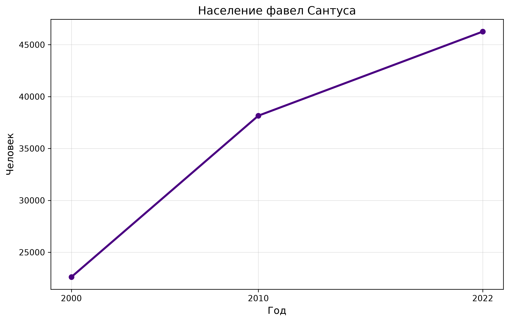
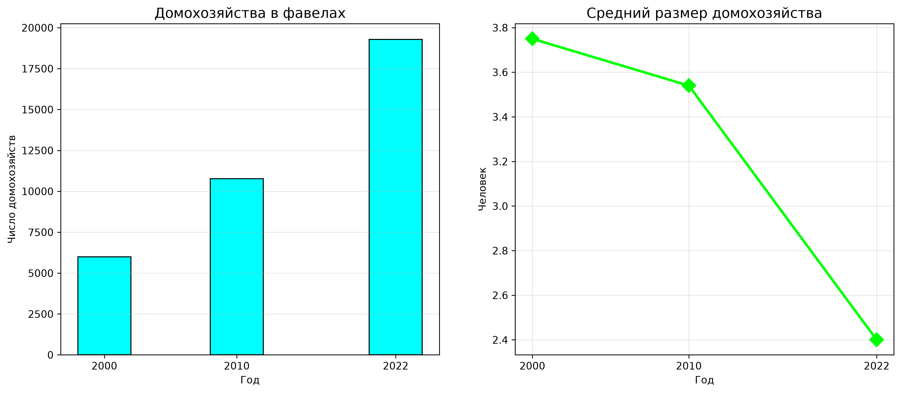
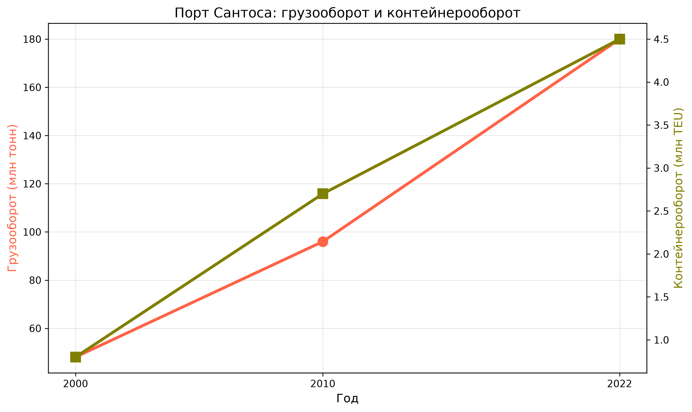
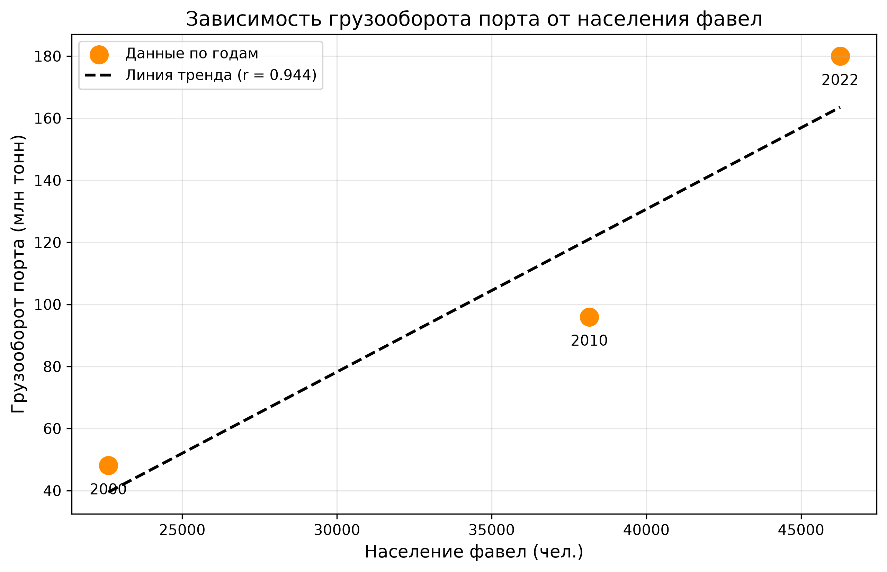

# Анализ зависимости между грузооборотом порта Сантуса и населением фавел

## О проекте
Развитие портовых городов неизбежно порождает городские конфликты. Как отмечается в современных исследованиях, разрастание площади порта и увеличение грузооборота приводит к отчуждению территории города в пользу портово-логистической инфраструктуры.

Город Сантус (Бразилия), где расположен крупнейший порт страны, представляет собой яркий пример такого процесса. С ростом порта создаются физические барьеры, отделяющие его от города, такие как Avenida Perimetral, а малообеспеченные слои общества вытесняются на периферию.

Цель данного проекта — с помощью языка Python (библиотеки NumPy и Matplotlib) проанализировать, как динамика развития порта соотносится с ростом населения в городских фавелах, и выявить силу этой зависимости на основе количественных данных.

## Источники данных и подготовка датасета
Для анализа использовались официальные статистические данные Бразилии за 2000, 2010 и 2022 годы. На основе первичных материалов был сформирован единый датасет `santos_data.txt`.

**Первичные источники:**
1. **ANTAQ** (Agência Nacional de Transportes Aquaviários) — данные о грузообороте и контейнерообороте порта Сантус (на основе отчетов о движении грузов, файлы `Movimentacao`).
2. **IBGE** (Instituto Brasileiro de Geografia e Estatística) — данные переписей населения о фавелах (субнормальных агломерациях) и доходах. Были использованы следующие таблицы:
   - *Domicílios particulares ocupados em aglomerados subnormais e Média de moradores* (домохозяйства и средний размер семьи в фавелах);
   - *População residente em favelas e comunidades urbanas* (население фавел);
   - *Количество фавел и городских поселений по муниципалитетам*;
   - *Медианный ежемесячный номинальный доход лиц в возрасте 10 лет и старше*;
   - *Таблица 1427 - Постоянные частные домохозяйства по классам номинального ежемесячного дохода*.

**Итоговый датасет `santos_data.txt` содержит следующие показатели по годам:**
- Год (2000, 2010, 2022)
- Грузооборот порта (млн тонн)
- Контейнерооборот (млн TEU)
- Население фавел (чел.)
- Домохозяйства в фавелах (ед.)
- Средний размер домохозяйства (чел.)
- Кол-во фавел (ед.)

## Визуализация, ограничения метода и пространственный анализ
В проекте построены графики динамики и график зависимости с линией тренда, показывающие высокую корреляцию (r = 0.94). Однако в реальности корреляция не всегда означает причинно-следственную связь.

Городская среда неоднородна, чтобы понять реальные причины процессов, необходимо смотреть не только на графики, но и на пространственное размещение объектов. В случае Сантуса порт несет разные последствия для пространственной динамики города, проявляясь в каждом районе по-своему:
- В районе **Праинья** порт расширяется вглубь города, вытесняя жилье.
- В районе **Сабо** пространственная фиксация контейнерного кластера блокирует развитие общественных пространств.
- В районе **Валонгу** точечный редевелопмент на берегу привел к джентрификации и вытеснению бедных слоев.

Таким образом, количественный анализ дополняется качественным пространственным исследованием. Графики показывают общий тренд, но реальные конфликты и уникальность каждого района определяются его пространственным положением, историей застройки и доступом к ресурсам.

### Графики проекта





## Источники для построения графиков разных видов:
https://www.datacamp.com/zh/tutorial/types-of-data-plots-and-how-to-create-them-in-python 
https://github.com/Fechin/reference/blob/main/source/_posts/matplotlib.md
## Структура репозитория
- `notebooks/santos_analysis.ipynb` — Jupyter Notebook с кодом загрузки данных, расчетами, графиками и выводами.
- `data/santos_data.txt` — исходный датасет с показателями.
- `src/` — папка со скриптами.
- `main.py` — основной скрипт.
- `requirements.txt` — список необходимых библиотек (numpy, matplotlib).
- `output/` — папка с сохраненными графиками.

## Как запустить
1. Установите необходимые зависимости:
   ```bash
   pip install -r requirements.txt
